# LunaFlow analysis report — riantr/moonbit_ImageSegmentation@0.1.0

> Trace-driven (dynamic-first) control-flow, data-flow, value-range and slicing analysis for a mooncakes.io module.

## 1. Acquisition and version pinning

| Item | Value |
| --- | --- |
| Requested coordinate | `riantr/moonbit_ImageSegmentation` |
| Resolved version | `0.1.0` |
| Pinning strategy | explicit local directory; no registry resolution performed |
| Source root | `.` |
| Declared target | `js` |
| Direct dependencies | (none) |

## 2. Ingestion statistics

| Metric | Value |
| --- | --- |
| Source files parsed | 36 |
| Functions extracted | 348 |
| Statements understood | 4537 |
| Statements unsupported | 262 |
| Frontend coverage | 94.5% |
| Parse issues | 34 |
| CFG functions | 318 of 348 — the first 318 in file order; 30 functions had no CFG and can carry no CFG finding |
| Trace events | 236533 |
| Interpreted steps | 37263 |
| Observed functions | 150 |
| Wall time (analyzer) | 2509 ms |
| Selected level | L1 |

## 3. Proof-strength levels and funnel

The same program is analyzed at three proof strengths. Levels are cumulative: L2 adds abstract interpretation on top of L1, L3 adds contract verification on top of the escalated functions. `--funnel` runs all three and reports what each level adds.

### 3.1 Level definitions

| Level | Name | Engine | Input model | Result strength |
| --- | --- | --- | --- | --- |
| L1 | Interpreter | concrete execution on the formal interpreter | concrete boundary values (`--trials`) | observed facts; may miss unexecuted inputs and paths |
| L2 | Value | abstract interpretation over a value-set / interval domain | whole input sets (`Int` intervals, `Bool`/`String` sets, array length intervals) | exhaustive over the abstract state; may-taint and may-range alarms (false positives possible) |
| L3 | Proof-by-contract | WP-style weakest-precondition VC generation + interval decision | ACSL-style `//@ requires` / `//@ ensures` specs | `proved` / `failed` / `unknown` per verification condition; specs are mandatory |

### 3.2 Funnel

_Funnel not requested._ Run with `--funnel` (or `--level 2` / `--level 3`) to add the stronger levels.

## 4. Control-flow analysis

CFG nodes are built from the parsed statement tree; execution paths come from the concrete-execution trace engine. Dead/unreachable detection is static; path coverage and budget findings are dynamic. See `docs/design.md` §5 for the mapping rules.

### 4.1 CFG diagrams (top 8 by cyclomatic complexity)

#### `blob_label` (blob_labeler.mbt)

_Diagram omitted: 139 nodes exceeds the readability cap (90). Findings for this function are listed below._

#### `watershed` (watershed.mbt)

_Diagram omitted: 143 nodes exceeds the readability cap (90). Findings for this function are listed below._

#### `build_huffman_tree` (internal/zlib/huffman.mbt)

_Diagram omitted: 95 nodes exceeds the readability cap (90). Findings for this function are listed below._

#### `auto_threshold_renyi_entropy` (auto_threshold.mbt)

_Diagram omitted: 129 nodes exceeds the readability cap (90). Findings for this function are listed below._

#### `deflate_compress_dynamic_tokens` (internal/zlib/deflate_compress.mbt)

_Diagram omitted: 112 nodes exceeds the readability cap (90). Findings for this function are listed below._

#### `multi_otsu_thresholds` (multi_otsu.mbt)

_Diagram omitted: 91 nodes exceeds the readability cap (90). Findings for this function are listed below._

#### `build_huffman_lengths` (internal/zlib/deflate_compress.mbt)

```mermaid
flowchart TD
  classDef entryNode fill:#dcedc8,stroke:#33691e,stroke-width:2px
  classDef exitNode fill:#ffcdd2,stroke:#b71c1c,stroke-width:2px
  classDef branchNode fill:#fff9c4,stroke:#f9a825
  classDef loopNode fill:#e1bee7,stroke:#6a1b9a
  classDef mergeNode fill:#eceff1,stroke:#607d8b
  classDef deadNode fill:#eeeeee,stroke:#9e9e9e
  classDef stmtNode fill:#e3f2fd,stroke:#1565c0
  n0(["entry build_huffman_lengths"]):::entryNode
  n1(["exit"]):::exitNode
  n2["let mut active_count = 0"]:::stmtNode
  n3["let mut first_sym = - 1"]:::stmtNode
  n4["let mut second_sym = - 1"]:::stmtNode
  n5{{"for i in 0"}}:::loopNode
  n6{"if (freqs[i] #gt; 0)"}:::branchNode
  n7["active_count += 1"]:::stmtNode
  n8{"if (first_sym #lt; 0)"}:::branchNode
  n9["first_sym = i"]:::stmtNode
  n10{"if (second_sym #lt; 0)"}:::branchNode
  n11["second_sym = i"]:::stmtNode
  n12("merge"):::mergeNode
  n13("merge"):::mergeNode
  n14("merge"):::mergeNode
  n15("after-loop"):::mergeNode
  n16{"if (active_count == 0)"}:::branchNode
  n17["return None"]:::stmtNode
  n18("merge"):::mergeNode
  n19["let lengths : Array[Int] = Array::make(symbol_count, 0)"]:::stmtNode
  n20{"if (active_count == 1)"}:::branchNode
  n21["lengths[first_sym] = 1"]:::stmtNode
  n22["return Some(lengths)"]:::stmtNode
  n23("merge"):::mergeNode
  n24{"if (active_count == 2)"}:::branchNode
  n25["lengths[first_sym] = 1"]:::stmtNode
  n26["lengths[second_sym] = 1"]:::stmtNode
  n27["return Some(lengths)"]:::stmtNode
  n28("merge"):::mergeNode
  n29["let nodes : Array[HuffNode] =[]"]:::stmtNode
  n30["nodes.reserve_capacity(symbol_count * 2)"]:::stmtNode
  n31["let mut active_len = 0"]:::stmtNode
  n32{{"for i in 0"}}:::loopNode
  n33{"if (freqs[i] #gt; 0)"}:::branchNode
  n34["nodes.push({ freq : freqs[i], left : - 1, right : - 1, sym : i,})"]:::stmtNode
  n35["lengths[active_len] = nodes.length() - 1"]:::stmtNode
  n36["active_len += 1"]:::stmtNode
  n37("merge"):::mergeNode
  n38("after-loop"):::mergeNode
  n39{{"while (active_len #gt; 1)"}}:::loopNode
  n40["let mut min1 = 0"]:::stmtNode
  n41["let mut min2 = 1"]:::stmtNode
  n42{"if (nodes[lengths[min2]].freq #lt; nodes[lengths[min1]].freq)"}:::branchNode
  n43["let tmp = min1"]:::stmtNode
  n44["min1 = min2"]:::stmtNode
  n45["min2 = tmp"]:::stmtNode
  n46("merge"):::mergeNode
  n47{{"for i in 2"}}:::loopNode
  n48["let idx = lengths[i]"]:::stmtNode
  n49{"if (nodes[idx].freq #lt; nodes[lengths[min1]].freq)"}:::branchNode
  n50["min2 = min1"]:::stmtNode
  n51["min1 = i"]:::stmtNode
  n52{"if (nodes[idx].freq #lt; nodes[lengths[min2]].freq)"}:::branchNode
  n53["min2 = i"]:::stmtNode
  n54("merge"):::mergeNode
  n55("merge"):::mergeNode
  n56("after-loop"):::mergeNode
  n57["let a = lengths[min1]"]:::stmtNode
  n58["let b = lengths[min2]"]:::stmtNode
  n59{"if (min1 #gt; min2)"}:::branchNode
  n60["active_len = remove_active_at(lengths, active_len, min1)"]:::stmtNode
  n61["active_len = remove_active_at(lengths, active_len, min2)"]:::stmtNode
  n62["active_len = remove_active_at(lengths, active_len, min2)"]:::stmtNode
  n63["active_len = remove_active_at(lengths, active_len, min1)"]:::stmtNode
  n64("merge"):::mergeNode
  n65["nodes.push({ freq : nodes[a].freq + nodes[b].freq, left : a, right : b, sym : - 1,})"]:::stmtNode
  n66["lengths[active_len] = nodes.length() - 1"]:::stmtNode
  n67["active_len += 1"]:::stmtNode
  n68("after-loop"):::mergeNode
  n69["let root = lengths[0]"]:::stmtNode
  n70{{"for i in 0"}}:::loopNode
  n71["lengths[i] = 0"]:::stmtNode
  n72("after-loop"):::mergeNode
  n73{"if !fill_huffman_lengths(nodes, root, 0, max_bits, lengths)"}:::branchNode
  n74["return None"]:::stmtNode
  n75("merge"):::mergeNode
  n76["Some(lengths)"]:::stmtNode
  n0 --> n2
  n2 --> n3
  n3 --> n4
  n4 --> n5
  n7 --> n8
  n10 -->|true| n11
  n11 --> n12
  n10 -->|false| n12
  n8 -->|true| n9
  n8 -->|false| n10
  n9 --> n13
  n12 --> n13
  n6 -->|true| n7
  n13 --> n14
  n6 -->|false| n14
  n5 -->|true| n6
  n11 -.->|back| n5
  n5 -->|false| n15
  n15 --> n16
  n17 --> n1
  n16 -->|true| n17
  n16 -->|false| n18
  n18 --> n19
  n19 --> n20
  n21 --> n22
  n22 --> n1
  n20 -->|true| n21
  n20 -->|false| n23
  n23 --> n24
  n25 --> n26
  n26 --> n27
  n27 --> n1
  n24 -->|true| n25
  n24 -->|false| n28
  n28 --> n29
  n29 --> n30
  n30 --> n31
  n31 --> n32
  n34 --> n35
  n35 --> n36
  n33 -->|true| n34
  n36 --> n37
  n33 -->|false| n37
  n32 -->|true| n33
  n36 -.->|back| n32
  n32 -->|false| n38
  n38 --> n39
  n40 --> n41
  n41 --> n42
  n43 --> n44
  n44 --> n45
  n42 -->|true| n43
  n45 --> n46
  n42 -->|false| n46
  n46 --> n47
  n48 --> n49
  n50 --> n51
  n52 -->|true| n53
  n53 --> n54
  n52 -->|false| n54
  n49 -->|true| n50
  n49 -->|false| n52
  n51 --> n55
  n54 --> n55
  n47 -->|true| n48
  n53 -.->|back| n47
  n47 -->|false| n56
  n56 --> n57
  n57 --> n58
  n58 --> n59
  n60 --> n61
  n62 --> n63
  n59 -->|true| n60
  n59 -->|false| n62
  n61 --> n64
  n63 --> n64
  n64 --> n65
  n65 --> n66
  n66 --> n67
  n39 -->|true| n40
  n67 -.->|back| n39
  n39 -->|false| n68
  n68 --> n69
  n69 --> n70
  n70 -->|true| n71
  n71 -.->|back| n70
  n70 -->|false| n72
  n72 --> n73
  n74 --> n1
  n73 -->|true| n74
  n73 -->|false| n75
  n75 --> n76
  n76 --> n1
```



Observed path (trial 0, first 6 events): `def@356` -> `def@357` -> `def@358` -> `cond@369` -> `ret@370` -> `def@351`

#### `build_dynamic_trees` (internal/zlib/inflate.mbt)

```mermaid
flowchart TD
  classDef entryNode fill:#dcedc8,stroke:#33691e,stroke-width:2px
  classDef exitNode fill:#ffcdd2,stroke:#b71c1c,stroke-width:2px
  classDef branchNode fill:#fff9c4,stroke:#f9a825
  classDef loopNode fill:#e1bee7,stroke:#6a1b9a
  classDef mergeNode fill:#eceff1,stroke:#607d8b
  classDef deadNode fill:#eeeeee,stroke:#9e9e9e
  classDef stmtNode fill:#e3f2fd,stroke:#1565c0
  n0(["entry build_dynamic_trees"]):::entryNode
  n1(["exit"]):::exitNode
  n2["let hlit = reader.read_bits(5) + 257"]:::stmtNode
  n3["let hdist = reader.read_bits(5) + 1"]:::stmtNode
  n4["let hclen = reader.read_bits(4) + 4"]:::stmtNode
  n5["let order : FixedArray[Int] =[ 16, 17, 18, 0, 8, 7, 9, 6, 10, 5, 11, 4, 12, 3, 13, 2, 1..."]:::stmtNode
  n6["let code_len_lengths : Array[Int] =[]"]:::stmtNode
  n7{{"for _ in 0"}}:::loopNode
  n8["code_len_lengths.push(0)"]:::stmtNode
  n9("after-loop"):::mergeNode
  n10{{"for i in 0"}}:::loopNode
  n11["code_len_lengths[order[i]] = reader.read_bits(3)"]:::stmtNode
  n12("after-loop"):::mergeNode
  n13["let code_len_tree = build_huffman_tree(code_len_lengths, 7)"]:::stmtNode
  n14["let total = hlit + hdist"]:::stmtNode
  n15["let lengths : Array[Int] =[]"]:::stmtNode
  n16["let mut prev = 0"]:::stmtNode
  n17["let mut has_prev = false"]:::stmtNode
  n18{{"while (lengths.length() #lt; total)"}}:::loopNode
  n19["let sym = code_len_tree.decode(reader)"]:::stmtNode
  n20{"if (sym #lt;= 15)"}:::branchNode
  n21["lengths.push(sym)"]:::stmtNode
  n22["prev = sym"]:::stmtNode
  n23["has_prev = true"]:::stmtNode
  n24{"if (sym == 16)"}:::branchNode
  n25{"if !has_prev"}:::branchNode
  n26["raise ZlibError::InvalidData(Code length 16 with no previous length"]:::stmtNode
  n27[""]:::stmtNode
  n28("merge"):::mergeNode
  n29["let repeat = reader.read_bits(2) + 3"]:::stmtNode
  n30{"if ((lengths.length() + repeat) #gt; total)"}:::branchNode
  n31["raise ZlibError::InvalidData(Code length repeat overflows table"]:::stmtNode
  n32[""]:::stmtNode
  n33("merge"):::mergeNode
  n34{{"for _ in 0"}}:::loopNode
  n35["lengths.push(prev)"]:::stmtNode
  n36("after-loop"):::mergeNode
  n37{"if (sym == 17)"}:::branchNode
  n38["let repeat = reader.read_bits(3) + 3"]:::stmtNode
  n39{"if ((lengths.length() + repeat) #gt; total)"}:::branchNode
  n40["raise ZlibError::InvalidData(Code length repeat overflows table"]:::stmtNode
  n41[""]:::stmtNode
  n42("merge"):::mergeNode
  n43{{"for _ in 0"}}:::loopNode
  n44["lengths.push(0)"]:::stmtNode
  n45("after-loop"):::mergeNode
  n46["prev = 0"]:::stmtNode
  n47["has_prev = true"]:::stmtNode
  n48{"if (sym == 18)"}:::branchNode
  n49["let repeat = reader.read_bits(7) + 11"]:::stmtNode
  n50{"if ((lengths.length() + repeat) #gt; total)"}:::branchNode
  n51["raise ZlibError::InvalidData(Code length repeat overflows table"]:::stmtNode
  n52[""]:::stmtNode
  n53("merge"):::mergeNode
  n54{{"for _ in 0"}}:::loopNode
  n55["lengths.push(0)"]:::stmtNode
  n56("after-loop"):::mergeNode
  n57["prev = 0"]:::stmtNode
  n58["has_prev = true"]:::stmtNode
  n59["raise ZlibError::InvalidData(Invalid code length symbol"]:::stmtNode
  n60[""]:::stmtNode
  n61("merge"):::mergeNode
  n62("merge"):::mergeNode
  n63("merge"):::mergeNode
  n64("merge"):::mergeNode
  n65("after-loop"):::mergeNode
  n66["let lit_lengths : Array[Int] =[]"]:::stmtNode
  n67{{"for i in 0"}}:::loopNode
  n68["lit_lengths.push(lengths[i])"]:::stmtNode
  n69("after-loop"):::mergeNode
  n70["let dist_lengths : Array[Int] =[]"]:::stmtNode
  n71{{"for i in 0"}}:::loopNode
  n72["dist_lengths.push(lengths[hlit + i])"]:::stmtNode
  n73("after-loop"):::mergeNode
  n74["let lit_tree = build_huffman_tree(lit_lengths, 15)"]:::stmtNode
  n75["let dist_tree = if all_zero_lengths(dist_lengths) { build_huffman_tree([1], 1)} else { ..."]:::stmtNode
  n76["(lit_tree, dist_tree)"]:::stmtNode
  n0 --> n2
  n2 --> n3
  n3 --> n4
  n4 --> n5
  n5 --> n6
  n6 --> n7
  n7 -->|true| n8
  n8 -.->|back| n7
  n7 -->|false| n9
  n9 --> n10
  n10 -->|true| n11
  n11 -.->|back| n10
  n10 -->|false| n12
  n12 --> n13
  n13 --> n14
  n14 --> n15
  n15 --> n16
  n16 --> n17
  n17 --> n18
  n19 --> n20
  n21 --> n22
  n22 --> n23
  n26 --> n27
  n25 -->|true| n26
  n27 --> n28
  n25 -->|false| n28
  n28 --> n29
  n29 --> n30
  n31 --> n32
  n30 -->|true| n31
  n32 --> n33
  n30 -->|false| n33
  n33 --> n34
  n34 -->|true| n35
  n35 -.->|back| n34
  n34 -->|false| n36
  n38 --> n39
  n40 --> n41
  n39 -->|true| n40
  n41 --> n42
  n39 -->|false| n42
  n42 --> n43
  n43 -->|true| n44
  n44 -.->|back| n43
  n43 -->|false| n45
  n45 --> n46
  n46 --> n47
  n49 --> n50
  n51 --> n52
  n50 -->|true| n51
  n52 --> n53
  n50 -->|false| n53
  n53 --> n54
  n54 -->|true| n55
  n55 -.->|back| n54
  n54 -->|false| n56
  n56 --> n57
  n57 --> n58
  n59 --> n60
  n48 -->|true| n49
  n48 -->|false| n59
  n58 --> n61
  n60 --> n61
  n37 -->|true| n38
  n37 -->|false| n48
  n47 --> n62
  n61 --> n62
  n24 -->|true| n25
  n24 -->|false| n37
  n36 --> n63
  n62 --> n63
  n20 -->|true| n21
  n20 -->|false| n24
  n23 --> n64
  n63 --> n64
  n18 -->|true| n19
  n60 -.->|back| n18
  n18 -->|false| n65
  n65 --> n66
  n66 --> n67
  n67 -->|true| n68
  n68 -.->|back| n67
  n67 -->|false| n69
  n69 --> n70
  n70 --> n71
  n71 -->|true| n72
  n72 -.->|back| n71
  n71 -->|false| n73
  n73 --> n74
  n74 --> n75
  n75 --> n76
  n76 --> n1
```

Observed path (trial 0, first 11 events): `call@189` -> `def@189` -> `call@190` -> `def@190` -> `call@191` -> `def@191` -> `def@192` -> `def@195` -> `call@202` -> `def@202` -> `def@186`

### 4.2 CFG findings

| Rule | Severity | Function | Location | Message | Method | Confidence |
| --- | --- | --- | --- | --- | --- | --- |
| BUDGET-EXCEEDED | warning | gray_to_rgb | cmd/seg/main.mbt:311 | execution budget exhausted; loop may be non-terminating or inputs too large | dynamic | 0.6 |
| BUDGET-EXCEEDED | warning | read_gray_raw | cmd/seg/png_cmd.mbt:187 | execution budget exhausted; loop may be non-terminating or inputs too large | dynamic | 0.6 |
| BUDGET-EXCEEDED | warning | write_stored_deflate_blocks | internal/zlib/zlib.mbt:89 | execution budget exhausted; loop may be non-terminating or inputs too large | dynamic | 0.6 |
| BUDGET-EXCEEDED | warning | adler32_impl | internal/zlib/adler32_simd.mbt:81 | execution budget exhausted; loop may be non-terminating or inputs too large | dynamic | 0.6 |
| BUDGET-EXCEEDED | warning | adler32_fixed_impl | internal/zlib/adler32_simd.mbt:116 | execution budget exhausted; loop may be non-terminating or inputs too large | dynamic | 0.6 |
| BUDGET-EXCEEDED | warning | reverse_bits | internal/zlib/huffman.mbt:122 | execution budget exhausted; loop may be non-terminating or inputs too large | dynamic | 0.6 |
| BUDGET-EXCEEDED | warning | reverse_bits | internal/zlib/huffman.mbt:122 | execution budget exhausted; loop may be non-terminating or inputs too large | dynamic | 0.6 |
| BUDGET-EXCEEDED | warning | reverse_bits | internal/zlib/huffman.mbt:122 | execution budget exhausted; loop may be non-terminating or inputs too large | dynamic | 0.6 |
| BUDGET-EXCEEDED | warning | reverse_bits | internal/zlib/huffman.mbt:120 | execution budget exhausted; loop may be non-terminating or inputs too large | dynamic | 0.6 |
| BUDGET-EXCEEDED | warning | adler32_impl | internal/zlib/adler32_simd.mbt:83 | execution budget exhausted; loop may be non-terminating or inputs too large | dynamic | 0.6 |
| BUDGET-EXCEEDED | warning | adler32_fixed_impl | internal/zlib/adler32_simd.mbt:118 | execution budget exhausted; loop may be non-terminating or inputs too large | dynamic | 0.6 |
| BUDGET-EXCEEDED | warning | build_tokens | internal/zlib/deflate_compress.mbt:274 | execution budget exhausted; loop may be non-terminating or inputs too large | dynamic | 0.6 |

### 4.3 Static vs dynamic attribution

| Signal | Method | What a hit means | Known limitation |
| --- | --- | --- | --- |
| Unreachable statement | static | no CFG predecessor; often after `return`/`break` | parser gaps can hide real predecessors |
| Infinite loop | static + dynamic | constant-true condition without break, or iteration cap reached | loops whose exit depends on unmodelled calls are reported as *budget*, not proven infinite |
| Uncovered code | dynamic (coverage import) | zero hits in the observed test suite | absence of execution is not proof of dead code |

## 5. Data flow and taint

Sources are entry-function parameters (and `@env.args` when the frontend sees it); propagation follows recorded definitions and the variables read by each statement; sinks are array-index expressions and allocation sizes. The graph below is the *observed* propagation, not a may-analysis over all inputs.

```mermaid
flowchart LR
  classDef src fill:#ffcdd2,stroke:#b71c1c,stroke-width:2px
  classDef step fill:#fff9c4,stroke:#f9a825
  classDef sink fill:#c8e6c9,stroke:#1b5e20,stroke-width:2px
  t0["source: path"]:::src
  t1["source: path"]:::src
  t2["source: path"]:::src
  t3["source: path"]:::src
  t4["source: path"]:::src
  t5["source: content"]:::src
  t6["source: path"]:::src
  t7["source: content"]:::src
  t8["source: path"]:::src
  t9["source: content"]:::src
  t10["source: path"]:::src
  t11["source: content"]:::src
  t12["source: path"]:::src
  t13["source: content"]:::src
  t14["source: path"]:::src
  t15["source: content"]:::src
  t16["source: path"]:::src
  t17["source: content"]:::src
  t18["source: path"]:::src
  t19["source: content"]:::src
  t20["source: path"]:::src
  t21["source: path"]:::src
  t22["source: path"]:::src
  t23["source: path"]:::src
  t24["source: path"]:::src
  t25["res = ?"]:::step
  t26["source: path"]:::src
  t27["res = ?"]:::step
  t28["source: path"]:::src
  t29["res = ?"]:::step
  t30["source: path"]:::src
  t31["res = ?"]:::step
  t32["source: path"]:::src
  t33["source: content"]:::src
  t34["res = ?"]:::step
  t35["source: path"]:::src
  t36["source: content"]:::src
  t37["res = ?"]:::step
  t38["source: path"]:::src
  t39["source: content"]:::src
  t24 -->|propagates| t25
  t26 -->|propagates| t27
  t28 -->|propagates| t29
  t30 -->|propagates| t31
  t32 -->|propagates| t34
  t33 -->|propagates| t34
  t35 -->|propagates| t37
  t36 -->|propagates| t37
```



### 5.1 Taint sinks

| Rule | Severity | Function | Location | Message | Method | Confidence |
| --- | --- | --- | --- | --- | --- | --- |
| TAINT-INDEX | error | byte_array_to_extern | cmd/seg/fs/fs_wasm.mbt:93 | tainted value reaches an array index / buffer offset | dynamic+symbolic | 0.8 |
| TAINT-INDEX-RANGE | warning | parse_options | cmd/seg/main.mbt:130 | untrusted input determines an array index; the observed index was inside the array, so no out-of-bounds access was witnessed | dynamic+symbolic | 0.5 |
| TAINT-INDEX | error | read_gray | cmd/seg/main.mbt:290 | tainted value reaches an array index / buffer offset | dynamic+symbolic | 0.8 |
| TAINT-INDEX | error | gray_to_rgb | cmd/seg/main.mbt:310 | tainted value reaches an array index / buffer offset | dynamic+symbolic | 0.8 |
| TAINT-INDEX-RANGE | warning | write_scalars | cmd/seg/main.mbt:380 | untrusted input determines an array index; the observed index was inside the array, so no out-of-bounds access was witnessed | dynamic+symbolic | 0.5 |
| TAINT-INDEX | error | rgb_to_luma | cmd/seg/png_cmd.mbt:64 | tainted value reaches an array index / buffer offset | dynamic+symbolic | 0.8 |
| TAINT-INDEX | error | rgb_to_luma | cmd/seg/png_cmd.mbt:65 | tainted value reaches an array index / buffer offset | dynamic+symbolic | 0.8 |
| TAINT-INDEX | error | rgb_to_luma | cmd/seg/png_cmd.mbt:66 | tainted value reaches an array index / buffer offset | dynamic+symbolic | 0.8 |
| TAINT-INDEX-RANGE | warning | cmd_results_png | cmd/seg/png_cmd.mbt:244 | untrusted input determines an array index; the observed index was inside the array, so no out-of-bounds access was witnessed | dynamic+symbolic | 0.5 |
| TAINT-INDEX | error | write_stored_deflate_blocks | internal/zlib/zlib.mbt:87 | tainted value reaches an array index / buffer offset | dynamic+symbolic | 0.8 |
| TAINT-INDEX | error | adler32_impl | internal/zlib/adler32_simd.mbt:79 | tainted value reaches an array index / buffer offset | dynamic+symbolic | 0.8 |
| TAINT-INDEX | error | adler32_fixed_impl | internal/zlib/adler32_simd.mbt:114 | tainted value reaches an array index / buffer offset | dynamic+symbolic | 0.8 |
| TAINT-INDEX | error | HuffmanTree::decode | internal/zlib/huffman.mbt:82 | tainted value reaches an array index / buffer offset | dynamic+symbolic | 0.8 |
| TAINT-INDEX | error | HuffmanTree::decode | internal/zlib/huffman.mbt:84 | tainted value reaches an array index / buffer offset | dynamic+symbolic | 0.8 |
| TAINT-INDEX | error | build_huffman_tree | internal/zlib/huffman.mbt:139 | tainted value reaches an array index / buffer offset | dynamic+symbolic | 0.8 |
| TAINT-INDEX-RANGE | warning | build_huffman_tree | internal/zlib/huffman.mbt:153 | untrusted input determines an array index; the observed index was inside the array, so no out-of-bounds access was witnessed | dynamic+symbolic | 0.5 |
| TAINT-INDEX-RANGE | warning | build_huffman_tree | internal/zlib/huffman.mbt:163 | untrusted input determines an array index; the observed index was inside the array, so no out-of-bounds access was witnessed | dynamic+symbolic | 0.5 |
| TAINT-INDEX | error | build_huffman_tree | internal/zlib/huffman.mbt:165 | tainted value reaches an array index / buffer offset | dynamic+symbolic | 0.8 |
| TAINT-INDEX | error | build_huffman_tree | internal/zlib/huffman.mbt:167 | tainted value reaches an array index / buffer offset | dynamic+symbolic | 0.8 |
| TAINT-INDEX-RANGE | warning | build_huffman_tree | internal/zlib/huffman.mbt:186 | untrusted input determines an array index; the observed index was inside the array, so no out-of-bounds access was witnessed | dynamic+symbolic | 0.5 |
| TAINT-INDEX | error | BitReader::read_u16_le_aligned | internal/zlib/bitreader.mbt:107 | tainted value reaches an array index / buffer offset | dynamic+symbolic | 0.8 |
| TAINT-INDEX | error | BitReader::read_u16_le_aligned | internal/zlib/bitreader.mbt:108 | tainted value reaches an array index / buffer offset | dynamic+symbolic | 0.8 |
| TAINT-INDEX | error | hash3 | internal/zlib/deflate_compress.mbt:184 | tainted value reaches an array index / buffer offset | dynamic+symbolic | 0.8 |
| TAINT-INDEX | error | hash3 | internal/zlib/deflate_compress.mbt:185 | tainted value reaches an array index / buffer offset | dynamic+symbolic | 0.8 |
| TAINT-INDEX | error | hash3 | internal/zlib/deflate_compress.mbt:186 | tainted value reaches an array index / buffer offset | dynamic+symbolic | 0.8 |
| TAINT-INDEX | error | build_tokens | internal/zlib/deflate_compress.mbt:253 | tainted value reaches an array index / buffer offset | dynamic+symbolic | 0.8 |
| TAINT-INDEX | error | build_tokens | internal/zlib/deflate_compress.mbt:254 | tainted value reaches an array index / buffer offset | dynamic+symbolic | 0.8 |
| TAINT-INDEX | error | build_tokens | internal/zlib/deflate_compress.mbt:255 | tainted value reaches an array index / buffer offset | dynamic+symbolic | 0.8 |
| TAINT-INDEX | error | match_len | internal/zlib/deflate_match_scalar.mbt:5 | tainted value reaches an array index / buffer offset | dynamic+symbolic | 0.8 |
| TAINT-INDEX | error | build_tokens | internal/zlib/deflate_compress.mbt:276 | tainted value reaches an array index / buffer offset | dynamic+symbolic | 0.8 |
| TAINT-INDEX | error | fill_huffman_lengths | internal/zlib/deflate_compress.mbt:322 | tainted value reaches an array index / buffer offset | dynamic+symbolic | 0.8 |
| TAINT-INDEX | error | header_length_at | internal/zlib/deflate_compress.mbt:502 | tainted value reaches an array index / buffer offset | dynamic+symbolic | 0.8 |
| TAINT-INDEX | error | write_rle_length_symbol | internal/zlib/deflate_compress.mbt:565 | tainted value reaches an array index / buffer offset | dynamic+symbolic | 0.8 |
| TAINT-INDEX | error | rle_length_symbol_bit_length | internal/zlib/deflate_compress.mbt:577 | tainted value reaches an array index / buffer offset | dynamic+symbolic | 0.8 |

### 5.2 L2 abstract findings (may-analysis)

_Level 2 was not executed._ Run with `--level 2` or `--funnel`.


## 6. Value ranges

Ranges are the union of concrete samples across synthesized input trials. They are *observed* intervals, not abstract-interpretation fixpoints: a missing input can hide a wider interval.

### 6.1 Per-program-point observations

Every definition event is keyed by function, source line and variable, so a value can be inspected at the exact program point that produced it (the full stream is in the JSONL trace).

| Function | Line | Variable | Observed values |
| --- | --- | --- | --- |
| crc32 | 46 | i | ? |
| crc32 | 52 | i | ? |
| crc32 | 38 | crc | ? |
| crc32 | 39 | len | ? |
| crc32 | 42 | crc | ? |
| crc32 | 48 | idx | ? |
| crc32 | 51 | crc | ? |
| hash3 | 184 | b0 | ? |
| hash3 | 185 | b1 | ? |
| hash3 | 186 | b2 | ? |
| main | 31 | argv | () |
| main | 41 | opts | () |
| cmd_run | 788 | k | 0 |
| match_len | 4 | l | ? |
| match_len | 6 | l | ? |
| user_args | 74 | k | 2 |
| user_args | 77 | k | 3, 4, 5, 6, 7, 8 |
| user_args | 88 | k | 1 |
| user_args | 91 | k | 2, 3, 4, 5, 6, 7 |
| algo_siox | 736 | i | 0 |
| algo_siox | 738 | v | ? |
| algo_siox | 746 | i | 1, 2, 3, 4, 5, 6 |
| cmd_run | 784 | img | () |
| main | 36 | command | ? |
| read_gray | 279 | n | 1, 0, -1, -2, -5, ? |
| read_gray | 288 | i | 0 |
| read_gray | 291 | i | 1, 2, 3, 4, 5, 6 |
| write_rgb | 345 | n | ? |
| adler32_impl | 7 | i | 0 |
| algo_siox | 735 | cm | ? |
| cmd_otsu | 864 | img | () |
| rgb_to_luma | 60 | n | ? |
| rgb_to_luma | 62 | i | 0 |
| rgb_to_luma | 64 | r | ? |
| rgb_to_luma | 65 | g | ? |
| rgb_to_luma | 66 | b | ? |
| rgb_to_luma | 68 | i | 1, 2, 3, 4, 5, 6 |
| write_gray | 322 | n | ? |
| adler32_impl | 19 | i | ? |
| adler32_impl | 57 | a | ? |
| adler32_impl | 58 | b | ? |
| adler32_impl | 59 | i | 0 |
| adler32_impl | 5 | s1 | ? |
| adler32_impl | 6 | s2 | ? |
| adler32_impl | 74 | a | ? |
| adler32_impl | 75 | b | ? |
| adler32_impl | 76 | i | ? |
| adler32_impl | 79 | a | ? |
| adler32_impl | 80 | b | ? |
| adler32_impl | 81 | i | ? |
| adler32_impl | 83 | a | ? |
| adler32_impl | 84 | b | ? |
| algo_siox | 734 | rgb | () |
| cmd_run | 790 | parts | [(), (), (), (), (), (), (), (), (), (), ()] |
| crc32 | 40 | bulk_end | ? |
| file_exists | 287 | _ | ? |
| gray_to_rgb | 306 | n | ? |
| gray_to_rgb | 308 | i | 0 |
| gray_to_rgb | 310 | v | ? |
| gray_to_rgb | 314 | i | 1, 2, 3, 4, 5, 6 |
| user_args | 72 | argv | ? |
| user_args | 73 | args | [] |
| user_args | 86 | argv | ? |
| user_args | 87 | args | [] |
| adler32_impl | 17 | s1 | ? |
| adler32_impl | 18 | s2 | ? |
| adler32_impl | 8 | len | ? |
| algo_retfm | 643 | rgb | () |
| build_tokens | 243 | h | () |
| build_tokens | 256 | l | () |
| cmd_run | 785 | outdir | ? |
| cmd_to_png | 170 | img | () |
| load_raw_gray | 95 | n | ?, 1, 0, -1, -2, -5 |
| read_rgb_raw | 194 | n | 3, 0, -3, -6, -15 |
| read_rgb_raw | 196 | i | 0 |
| read_rgb_raw | 199 | i | 1, 2, 3 |
| adler32_impl | 56 | len | ? |
| algo_blob | 506 | blob4 | ? |
| algo_blob | 508 | blob8 | ? |
| cmd_run | 787 | scalars | [] |
| parse_options | 128 | i | 1 |
| parse_options | 134 | i | 3, 16, 29, 42, 55, 68 |
| parse_options | 137 | i | 5, 18, 31, 44, 57, 70 |
| parse_options | 140 | i | 7, 20, 33, 46, 59, 72 |
| parse_options | 143 | i | 9, 22, 35, 48, 61, 74 |
| parse_options | 146 | i | 11, 24, 37, 50, 63, 76 |
| parse_options | 149 | i | 13, 26, 39, 52, 65, 78 |
| parse_options | 151 | i | 14, 27, 40, 53, 66, 79 |
| read_gray_raw | 180 | n | 1, 0, -1, -2, -5, ? |
| read_gray_raw | 182 | i | 0 |
| read_gray_raw | 185 | i | 1, 2, 3, 4, 5, 6 |
| read_gray | 278 | bytes | () |
| write_rgb | 346 | bytes | ? |
| write_scalars | 378 | i | 0 |
| write_scalars | 381 | i | 1, 2, 3, 4, 5, 6 |
| algo_blob | 526 | bgcol4 | ? |
| algo_blob | 528 | bgcol8 | ? |
| algo_rats | 716 | result | ? |
| algo_siox | 748 | result | ? |
| build_tokens | 234 | len | ? |
| build_tokens | 237 | pos | 0 |
| build_tokens | 274 | pos | ? |
| build_tokens | 278 | pos | ? |
| cmd_to_png | 148 | bytes | () |
| crc32_bulk_impl | 36 | i | 0 |
| normalize_path | 218 | i | 0 |
| read_gray | 287 | pixels | ? |
| reverse_bits | 119 | bit | 1, 0, ? |
| write_gray | 323 | bytes | ? |
| adler32_impl | 11 | chunk | ? |
| adler32_impl | 62 | block | ? |
| algo_blob | 510 | scalars | [""blob4.numberOfLabels ""?"", ""blob4.failed "?", ""blob... |
| algo_blob | 518 | noedge4 | ? |
| algo_blob | 520 | noedge8 | ? |
| algo_multi_otsu | 417 | k | 0 |
| algo_multi_otsu | 421 | k | 1, 2, 3, 4 |
| algo_multi_otsu | 428 | k | 0 |
| algo_multi_otsu | 433 | j | 0 |
| algo_multi_otsu | 439 | j | 1, 2, 3, 4, 5 |
| algo_multi_otsu | 441 | k | 1, 2, 3 |
| build_tokens | 235 | head | ? |
| build_tokens | 236 | prev | ? |
| cmd_results_png | 242 | k | 0 |
| cmd_results_png | 254 | k | 1, 2, 3, 4, 5, 6 |
| crc32_bulk_impl | 28 | t0 | ? |
| crc32_bulk_impl | 29 | t1 | ? |
| crc32_bulk_impl | 30 | t2 | ? |
| crc32_bulk_impl | 31 | t3 | ? |
| crc32_bulk_impl | 32 | t4 | ? |
| crc32_bulk_impl | 33 | t5 | ? |
| crc32_bulk_impl | 34 | t6 | ? |
| crc32_bulk_impl | 35 | t7 | ? |
| parse_options | 124 | out | "" |
| parse_options | 125 | dir | "." |
| parse_options | 130 | key | ?, "x", "" |
| parse_options | 139 | out | ? |
| parse_options | 142 | dir | ? |
| rgb_to_luma | 61 | pixels | ? |
| string_to_extern | 64 | i | 0 |
| string_to_extern | 67 | i | 1, 2, 3, 4, 5, 6 |
| write_label_map | 330 | n | ? |
| adler32_impl | 66 | packed | ? |
| algo_retfm | 655 | scalars | [""retfm.otsuThreshold ""?""] |
| build_tokens | 245 | limit | ? |
| build_tokens | 251 | chain | 0 |
| cmd_otsu | 865 | threshold | ? |
| crc32_bulk_impl | 27 | crc | ? |
| densitometry_roi | 618 | x | ?, 0 |
| densitometry_roi | 619 | y | ?, 0, 1 |
| densitometry_roi | 620 | w | ?, 0 |
| densitometry_roi | 622 | w | 1 |
| densitometry_roi | 624 | h | ?, 0, 1, 2 |
| densitometry_roi | 626 | h | 1 |
| densitometry_roi | 629 | w | ?, -1, 0 |
| densitometry_roi | 632 | h | ?, -1, 0 |
| gray_to_rgb | 307 | pixels | ? |
| load_raw_gray | 84 | bytes | () |
| normalize_path | 217 | out | "", "abc", "../../etc/passwd", "0000000000000000000000000... |
| read_rgb_raw | 193 | bytes | () |
| retfm_variant | 705 | gray | ? |
| zlib_compress | 8 | result | ? |
| adler32_fixed_impl | 29 | i | 0 |
| adler32_fixed_impl | 40 | i | ? |
| adler32_fixed_impl | 92 | a | ? |
| adler32_fixed_impl | 93 | b | ? |
| adler32_fixed_impl | 94 | i | 0 |
| algo_otsu | 401 | threshold | ? |
| build_tokens | 233 | tokens | ? |
| cmd_results_png | 212 | dir | ? |
| count_rle_lengths | 514 | i | 0 |
| fixed_lit_code | 137 | code | 47, 48, 49, 50, 53, ? |
| fixed_lit_code | 140 | code | ? |
| fixed_lit_code | 143 | code | ?, 0 |
| fixed_lit_code | 146 | code | ? |
| inflate_blocks | 59 | btype | ? |
| normalize_path | 220 | next | ? |
| parse_options | 122 | input | "" |
| parse_options | 126 | width | 0 |
| parse_options | 131 | value | ? |
| parse_options | 133 | input | ? |
| parse_options | 145 | width | () |
| read_gray_raw | 179 | bytes | () |
| read_rgb_raw | 195 | pixels | ? |
| reverse_bits | 117 | result | 0 |
| reverse_bits | 120 | result | 1, 3, 7, 15, 31, 63 |
| write_rle_lengths | 642 | i | 0 |
| HuffmanTree::new | 19 | size | ? |
| adler32_fixed_impl | 109 | a | ? |
| adler32_fixed_impl | 110 | b | ? |
| adler32_fixed_impl | 111 | i | ? |
| adler32_fixed_impl | 114 | a | ? |
| adler32_fixed_impl | 115 | b | ? |
| adler32_fixed_impl | 116 | i | ? |
| adler32_fixed_impl | 118 | a | ? |
| adler32_fixed_impl | 119 | b | ? |
| adler32_fixed_impl | 26 | s1 | ? |
| adler32_fixed_impl | 27 | s2 | ? |
| adler32_fixed_impl | 38 | s1 | ? |
| adler32_fixed_impl | 39 | s2 | ? |
| algo_autothreshold | 457 | k | 0 |
| algo_autothreshold | 461 | k | 1, 2, 3, 4, 5, 6 |
| algo_mixture | 472 | mixture | ? |
| algo_mixture | 474 | scalars | [""mixture.threshold ""?"", ""mixture.mu1 ""?"", ""mixtur... |
| algo_retfm | 650 | threshold | ? |
| all_zero_lengths | 269 | len | 0, 1 |
| build_huffman_tree | 155 | c | ? |
| build_tokens | 246 | max_len | ? |
| cmd_algorithm | 821 | outdir | ? |
| cmd_results_png | 245 | path | """?"/""?"".raw"" |
| inflate_blocks | 58 | bfinal | ? |
| parse_options | 123 | outdir | "" |
| parse_options | 127 | height | 0 |
| parse_options | 136 | outdir | ? |
| parse_options | 148 | height | () |
| read_gray_raw | 181 | pixels | ? |
| string_from_extern | 77 | ch | ? |
| write_match | 197 | len_info | () |
| write_tokens_fixed | 286 | t | 0, 1, -1 |
| zlib_compress | 133 | offset | ? |
| zlib_compress | 6 | deflated | ? |
| adler32_fixed_impl | 28 | len | 0, 1, 3, 2 |
| adler32_fixed_impl | 91 | len | 0, 1, 3, 2 |
| adler32_impl | 10 | remaining | ? |
| adler32_impl | 61 | remaining | ? |
| adler32_impl | 63 | block_end | ? |
| algo_densitometry | 552 | rgb | () |
| algo_densitometry | 585 | roi | () |
| algo_multi_otsu | 430 | level | 2, 3, 5 |
| algo_retfm | 644 | retfm_gray | ? |
| build_tokens | 240 | best_len | 0 |
| build_tokens | 258 | best_len | () |
| byte_array_to_extern | 91 | i | 0 |
| byte_array_to_extern | 94 | i | 1, 2, 3, 4, 5, 6 |
| cmd_results_png | 213 | width | ? |
| cmd_results_png | 247 | image | () |
| deflate_reverse_bits | 83 | v | -1, 0, 47, 48, 49, 50 |
| deflate_reverse_bits | 85 | n | -1, 0, 1, 2, 5, 8 |
| deflate_reverse_bits | 88 | v | -1, 0, 23, 11, 5, 2 |
| deflate_reverse_bits | 89 | n | 0, 1, 4, 3, 2, 7 |
| load_input_gray | 117 | bytes | () |
| string_from_extern | 74 | buf | ? |
| write_label_map | 331 | bytes | ? |
| write_match | 203 | dist_info | () |
| write_scalars | 377 | content | "" |
| write_scalars | 380 | content | """""""" "", """""""""" """x""" "", """""""""""" """x""" ... |
| write_siox_mask | 364 | bytes | ? |
| zlib_compress | 7 | total_len | ? |
| HuffmanTree::decode | 82 | sym | ? |
| HuffmanTree::decode | 84 | len | ? |
| OsString::from_string | 23 | i | 0 |
| OsString::from_string | 25 | c | ? |
| OsString::from_string | 36 | i | 1, 2, 3, 4, 5, 6 |
| algo_multi_otsu | 427 | levels | [2, 3, 5] |
| algo_multi_otsu | 431 | result | ? |
| build_huffman_tree | 131 | len | 0 |
| build_huffman_tree | 153 | len | 0, ? |
| build_huffman_tree | 163 | len | 0 |
| build_huffman_tree | 165 | rev | ? |
| build_huffman_tree | 186 | len | 0 |
| build_tokens | 239 | remaining | ? |
| build_tokens | 241 | best_dist | 0 |
| build_tokens | 244 | candidate | ? |
| build_tokens | 259 | best_dist | ? |
| cmd_results_png | 214 | height | ? |
| inflate_blocks | 56 | is_final | false |
| string_to_extern | 63 | handle | ? |
| BitReader::peek_bits | 66 | one | ? |
| HuffmanTree::decode | 81 | bits | ? |
| HuffmanTree::insert | 52 | node | 0 |
| adler32_fixed_impl | 32 | chunk | ? |
| adler32_fixed_impl | 97 | block | ? |
| adler32_impl | 64 | simd_chunks | ? |
| algo_multi_otsu | 416 | scalars | ["multiotsu.level 4"] |
| algo_multithresholder | 768 | t | 0 |
| algo_multithresholder | 771 | t | 1, 2, 3, 4, 5, 6 |
| build_huffman_tree | 137 | code | 0 |
| build_huffman_tree | 139 | code | ? |
| build_huffman_tree | 143 | tree | ? |
| count_rle_lengths | 515 | total | -2, -1 |
| create_dir_internal | 107 | res | ? |
| create_dir_internal | 150 | res | ? |
| deflate_reverse_bits | 84 | out | 0 |
| deflate_reverse_bits | 87 | out | 1, 3, 7, 15, 31, 0 |
| inflate_stored_block | 84 | len | ? |
| write_rle_lengths | 643 | total | -2, -1 |
| BitReader::peek_bits | 67 | mask | ? |
| OsString::from_string | 22 | buf | ? |
| algo_autothreshold | 459 | value | ? |
| algo_densitometry | 553 | colors | ? |
| algo_densitometry | 565 | binary | ? |
| algo_densitometry | 586 | region | ? |
| build_dynamic_trees | 189 | hlit | ? |
| fill_huffman_lengths | 324 | len | ? |
| inflate_stored_block | 85 | nlen | ? |
| rle_lengths_bit_length | 589 | i | 0 |
| string_from_extern | 75 | handle | ? |
| BitWriter::write_bits | 21 | take | ? |
| BitWriter::write_bits | 22 | mask | ? |
| adler32_fixed_impl | 101 | packed | ? |
| algo_densitometry | 554 | options | ? |
| ... | ... | ... | (truncated at 300 rows) |

### 6.2 Function-level range union (L1)

| Function | Variable | Min | Max | Samples | Observed values | First site |
| --- | --- | --- | --- | --- | --- | --- |
| cmd_run | k | 0 | 0 | 1 | 0 | cmd/seg/main.mbt:788:3 |
| algo_siox | i | 0 | 64 | 260 | 0, 1, 2, 3, 4, 5, 6, 7, 8, 9, 10, 11 | cmd/seg/main.mbt:736:3 |
| read_gray | i | 0 | 64 | 278 | 0, 1, 2, 3, 4, 5, 6, 7, 8, 9, 10, 11 | cmd/seg/main.mbt:288:3 |
| read_gray | n | -5 | 1 | 16 | 1, 0, -1, -2, -5 | cmd/seg/main.mbt:279:3 |
| user_args | k | 1 | 66 | 195 | 2, 3, 4, 5, 6, 7, 8, 9, 10, 11, 12, 13 | cmd/seg/main.mbt:74:3 |
| is_png | <ret> | 0 | 0 | 5 | false | cmd/seg/png_cmd.mbt:18:1-31:2 |
| gray_to_rgb | i | 0 | 64 | 1035 | 0, 1, 2, 3, 4, 5, 6, 7, 8, 9, 10, 11 | cmd/seg/main.mbt:308:3 |
| rgb_to_luma | i | 0 | 64 | 65 | 0, 1, 2, 3, 4, 5, 6, 7, 8, 9, 10, 11 | cmd/seg/png_cmd.mbt:62:3 |
| adler32_impl | i | 0 | 0 | 15 | 0 | internal/zlib/adler32_simd.mbt:59:3 |
| read_rgb_raw | i | 0 | 3 | 11 | 0, 1, 2, 3 | cmd/seg/png_cmd.mbt:196:3 |
| read_rgb_raw | n | -15 | 3 | 8 | 3, 0, -3, -6, -15 | cmd/seg/png_cmd.mbt:194:3 |
| load_raw_gray | n | -5 | 1 | 8 | 1, 0, -1, -2, -5 | cmd/seg/png_cmd.mbt:95:3 |
| parse_options | i | 1 | 833 | 467 | 1, 3, 5, 7, 9, 11, 13, 14, 16, 18, 20, 22 | cmd/seg/main.mbt:128:3 |
| read_gray_raw | i | 0 | 64 | 778 | 0, 1, 2, 3, 4, 5, 6, 7, 8, 9, 10, 11 | cmd/seg/png_cmd.mbt:182:3 |
| read_gray_raw | n | -5 | 1 | 8 | 1, 0, -1, -2, -5 | cmd/seg/png_cmd.mbt:180:3 |
| write_scalars | i | 0 | 64 | 410 | 0, 1, 2, 3, 4, 5, 6, 7, 8, 9, 10, 11 | cmd/seg/main.mbt:378:3 |
| build_tokens | pos | 0 | 0 | 5 | 0 | internal/zlib/deflate_compress.mbt:237:3 |
| normalize_path | i | 0 | 0 | 347 | 0 | cmd/seg/main.mbt:218:3 |
| reverse_bits | bit | 0 | 1 | 256 | 1, 0 | internal/zlib/huffman.mbt:119:5 |
| algo_multi_otsu | j | 0 | 5 | 65 | 0, 1, 2, 3, 4, 5 | cmd/seg/main.mbt:433:5 |
| algo_multi_otsu | k | 0 | 4 | 45 | 0, 1, 2, 3, 4 | cmd/seg/main.mbt:417:3 |
| cmd_results_png | k | 0 | 11 | 12 | 0, 1, 2, 3, 4, 5, 6, 7, 8, 9, 10, 11 | cmd/seg/png_cmd.mbt:242:3 |
| crc32_bulk_impl | i | 0 | 0 | 8 | 0 | internal/zlib/crc32_scalar.mbt:36:3 |
| build_tokens | chain | 0 | 0 | 35 | 0 | internal/zlib/deflate_compress.mbt:251:7 |
| densitometry_roi | h | -1 | 2 | 23 | 1, 0, -1, 2 | cmd/seg/main.mbt:626:5 |
| densitometry_roi | w | -1 | 1 | 29 | 1, 0, -1 | cmd/seg/main.mbt:622:5 |
| densitometry_roi | x | 0 | 0 | 8 | 0 | cmd/seg/main.mbt:618:3 |
| densitometry_roi | y | 0 | 1 | 8 | 0, 1 | cmd/seg/main.mbt:619:3 |
| string_to_extern | i | 0 | 64 | 278 | 0, 1, 2, 3, 4, 5, 6, 7, 8, 9, 10, 11 | cmd/seg/fs/fs_wasm.mbt:64:3 |
| count_rle_lengths | i | 0 | 0 | 8 | 0 | internal/zlib/deflate_compress.mbt:514:3 |
| fixed_lit_code | code | 0 | 53 | 15 | 47, 48, 49, 50, 53, 0 | internal/zlib/deflate_compress.mbt:137:5 |
| parse_options | width | 0 | 0 | 5 | 0 | cmd/seg/main.mbt:126:3 |
| reverse_bits | result | -1 | 2147483647 | 516 | 0, 1, 3, 7, 15, 31, 63, 127, 255, 511, 1023, ... | internal/zlib/huffman.mbt:117:3 |
| write_rle_lengths | i | 0 | 0 | 8 | 0 | internal/zlib/deflate_compress.mbt:642:3 |
| adler32_fixed_impl | i | 0 | 0 | 12 | 0 | internal/zlib/adler32_simd.mbt:94:3 |
| algo_autothreshold | k | 0 | 64 | 325 | 0, 1, 2, 3, 4, 5, 6, 7, 8, 9, 10, 11 | cmd/seg/main.mbt:457:3 |
| all_zero_lengths | len | 0 | 1 | 4 | 0, 1 | internal/zlib/inflate.mbt:269:3-273:4 |
| parse_options | height | 0 | 0 | 5 | 0 | cmd/seg/main.mbt:127:3 |
| write_tokens_fixed | t | -1 | 1 | 6 | 0, 1, -1 | internal/zlib/deflate_compress.mbt:286:3-292:4 |
| algo_multi_otsu | level | 2 | 5 | 15 | 2, 3, 5 | cmd/seg/main.mbt:430:5 |
| build_tokens | best_len | 0 | 0 | 35 | 0 | internal/zlib/deflate_compress.mbt:240:5 |
| adler32_fixed_impl | len | 0 | 3 | 12 | 0, 1, 3, 2 | internal/zlib/adler32_simd.mbt:91:3 |
| all_zero_lengths | <ret> | 0 | 0 | 2 | false | internal/zlib/inflate.mbt:268:1-275:2 |
| build_huffman_tree | len | 0 | 0 | 579 | 0 | internal/zlib/huffman.mbt:131:3-135:4 |
| build_tokens | best_dist | 0 | 0 | 35 | 0 | internal/zlib/deflate_compress.mbt:241:5 |
| byte_array_to_extern | i | 0 | 64 | 845 | 0, 1, 2, 3, 4, 5, 6, 7, 8, 9, 10, 11 | cmd/seg/fs/fs_wasm.mbt:91:3 |
| deflate_reverse_bits | n | -1 | 9 | 1413 | -1, 0, 1, 2, 5, 4, 3, 8, 7, 6, 9 | internal/zlib/deflate_compress.mbt:85:3 |
| deflate_reverse_bits | v | -1 | 53 | 177 | -1, 0, 47, 23, 11, 5, 2, 1, 48, 24, 12, 6 | internal/zlib/deflate_compress.mbt:83:3 |
| OsString | from_string | 0 | 64 | 87 | 0, 1, 2, 3, 4, 5, 6, 7, 8, 9, 10, 11 |  |
| algo_multithresholder | t | 0 | 64 | 585 | 0, 1, 2, 3, 4, 5, 6, 7, 8, 9, 10, 11 | cmd/seg/main.mbt:768:3 |
| build_huffman_tree | code | 0 | 0 | 26 | 0 | internal/zlib/huffman.mbt:137:3 |
| count_rle_lengths | total | -2 | -1 | 8 | -2, -1 | internal/zlib/deflate_compress.mbt:515:3 |
| inflate_blocks | is_final | 0 | 0 | 16 | false | internal/zlib/inflate.mbt:56:3 |
| write_rle_lengths | total | -2 | -1 | 8 | -2, -1 | internal/zlib/deflate_compress.mbt:643:3 |
| HuffmanTree | insert | 0 | 0 | 5 | 0 |  |
| deflate_reverse_bits | out | 0 | 244 | 319 | 0, 1, 3, 7, 15, 31, 30, 61, 122, 244, 6, 12 | internal/zlib/deflate_compress.mbt:84:3 |
| rle_lengths_bit_length | i | 0 | 0 | 8 | 0 | internal/zlib/deflate_compress.mbt:589:3 |
| BitReader | peek_bits | 0 | 0 | 1 | 0 |  |
| fill_huffman_lengths | <ret> | 0 | 0 | 8 | false | internal/zlib/deflate_compress.mbt:315:1-340:2 |
| fixed_tokens_byte_length | t | -1 | 1 | 6 | 0, 1, -1 | internal/zlib/deflate_compress.mbt:298:3-309:4 |
| BitWriter | write_bits | -1 | 0 | 8 | -1, 0 |  |
| rle_lengths_bit_length | bits | 0 | 0 | 8 | 0 | internal/zlib/deflate_compress.mbt:588:3 |
| zlib_compress_stored | offset | 1 | 320 | 320 | 1, 2, 3, 4, 5, 6, 7, 8, 9, 10, 11, 12 | internal/zlib/zlib.mbt:202:7 |
| adler32_fixed_impl | remaining | 1 | 3 | 9 | 1, 3, 2 | internal/zlib/adler32_simd.mbt:96:5 |
| rle_lengths_bit_length | total | -2 | -1 | 8 | -2, -1 | internal/zlib/deflate_compress.mbt:590:3 |
| fixed_tokens_byte_length | bits | 3 | 3 | 4 | 3 | internal/zlib/deflate_compress.mbt:297:3 |
| build_canonical_codes | non_zero | 0 | 0 | 8 | 0 | internal/zlib/deflate_compress.mbt:444:3 |
| BitWriter | write_bits | -1 | 5 | 8 | -1, 0, 1, 2, 5 |  |
| build_huffman_lengths | first_sym | -1 | -1 | 8 | -1 | internal/zlib/deflate_compress.mbt:357:3 |
| write_stored_deflate_blocks | pos | 0 | 0 | 8 | 0 | internal/zlib/zlib.mbt:66:3 |
| build_huffman_lengths | second_sym | -1 | -1 | 8 | -1 | internal/zlib/deflate_compress.mbt:358:3 |
| build_canonical_codes | all_one_bit | 1 | 1 | 8 | true | internal/zlib/deflate_compress.mbt:445:3 |
| build_huffman_lengths | active_count | 0 | 0 | 8 | 0 | internal/zlib/deflate_compress.mbt:356:3 |
| write_stored_deflate_blocks | offset | -1 | 5 | 48 | -1, 0, 1, 2, 3, 4, 5 | internal/zlib/zlib.mbt:65:3 |

### 6.3 Abstract may-ranges (L2)

_Level 2 was not executed._

## 7. Program slicing

_No slice requested._

## 8. Contracts and verification conditions (L3)

_Level 3 was not executed._ Run with `--level 3` or `--funnel`.

## 9. Method summary

| Capability | Engine | Precision statement |
| --- | --- | --- |
| CFG + dead/unreachable | static (syntax-directed) | sound relative to the parsed subset; parser gaps are reported |
| Path coverage | dynamic (trace) | exact for executed trials; no guarantee for unexecuted paths |
| Taint (L1) | dynamic + symbolic labels | flow-sensitive within a trial; container field sensitivity is coarse |
| Taint (L2) | abstract interpretation | may-analysis over the input abstraction; loop widening loses precision |
| Ranges (L1) | dynamic sampling | union of observed values; not a proof |
| Ranges (L2) | interval / value-set domain | over-approximation at widening; sound relative to the abstract semantics |
| Contracts (L3) | WP-style VC + interval decision | `proved` only from entailed preconditions; `unknown` when facts are insufficient |
| Slicing | dynamic dependence graph | exact for the recorded trace; not a static closure |

## 10. Reproduction

```text
LunaFlow analyze riantr/moonbit_ImageSegmentation@latest --out reports/ --funnel
```

Full method description, comparison with Frama-C/TIS, Joern, CodeQL, SVF and Soot, and the acceptance tests are in `docs/design.md`.
